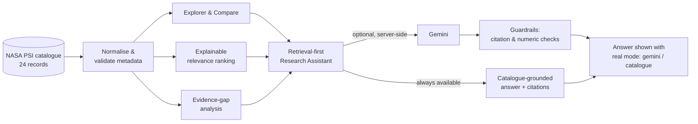

<div align="center">

# 🔥 FLARE-X

### Space Fire Research Intelligence

**Search, compare, rank and inspect NASA microgravity combustion research — with every answer tied to its source.**

[](https://flare-x.onrender.com/)
[](https://www.spaceappschallenge.org/)
[](https://www.spaceappschallenge.org/)


**[▶ Open the live app](https://flare-x.onrender.com/)** · **[API docs](https://flare-x.onrender.com/docs)** · **[Architecture](docs/ARCHITECTURE.md)** · **[Source verification](docs/NASA_PSI_VERIFICATION_REPORT.md)**

</div>

---

## 🛰️ The problem

Fire in a spacecraft behaves nothing like fire on Earth. Without gravity, flames form spheres, burn cooler, linger longer and can behave unpredictably. NASA has run decades of microgravity combustion investigations, but the findings are scattered across catalogue entries, and it is hard to answer simple questions quickly:

> *What has actually been studied? What is missing? Which investigations are relevant to **detecting**, **preventing** or **suppressing** a fire in space?*

## ✨ What FLARE-X does

FLARE-X turns a snapshot of **24 NASA Physical Sciences Informatics (PSI) Combustion Science investigations** into an interactive research workspace.

| | Feature | What you get |
|---|---|---|
| 🔎 | **Investigation Explorer** | Search, filter and sort all 24 records; open any one in a detail modal |
| ⚖️ | **Side-by-side Compare** | Compare 2–3 investigations on the same fields |
| 📊 | **Research Intelligence** | Transparent, explainable keyword relevance ranking by research theme |
| 🕳️ | **Evidence-gap view** | See exactly which fields were captured vs. *not available in the source* |
| 🤖 | **SI Research Studio** | Evidence-linked Q&A, cross-investigation analysis and research-brief generation |
| 📚 | **Citation audit** | Which DOIs were individually verified, and which still need checking |
| 🌌 | **3D evidence flow** | Interactive Three.js visual of how data moves through the platform |

## 🧠 How it works



### 🛡️ Honest by design

Most AI demos hide their limits. FLARE-X shows them.

- **Retrieval first.** The assistant retrieves PSI evidence *before* answering, and shows that evidence next to the answer.
- **Works without AI.** With no Gemini key, FLARE-X still answers from catalogue excerpts. Every response states which mode actually ran (`gemini` or `catalogue`).
- **Guardrails.** Gemini output is checked against retrieved evidence for unsupported citations and invented numbers. If it fails, FLARE-X falls back safely and reports a `fallback_reason` (quota, model access, timeout or validation failure).
- **Missing ≠ zero.** Unrecorded values read *"Not available in the provided source"*. Nothing is invented or filled in.
- **Secrets stay server-side.** The Gemini key is never exposed to the browser.

## 🚀 Try it

### Option 1: Live

👉 **https://flare-x.onrender.com/** (the free tier may take ~30 s to wake up on the first visit)

### Option 2: Run locally

**Prerequisites:** Python 3.12 · Node.js 22

**Terminal 1 — API** (project root)

```bash
python -m venv .venv
# Windows: .\.venv\Scripts\activate    macOS/Linux: source .venv/bin/activate
pip install -r backend/requirements-dev.txt
python -m pytest -q
python -m uvicorn backend.main:app --reload --host 127.0.0.1 --port 8000
```

Check <http://127.0.0.1:8000/health> → `{"status":"ok","records_loaded":24}`

**Terminal 2 — UI**

```bash
cd frontend
npm install
npm test
npm run dev
```

Open the URL Vite prints (usually <http://localhost:5173>). No `.env` file is needed for the default setup.

### Option 3: Docker (single origin)

```bash
docker build -t flare-x .
docker run -p 8000:8000 flare-x
```

See [Deployment](docs/DEPLOYMENT.md) for Render and acceptance tests.

## 🔑 Optional: enable Gemini

Copy `.env.example` to `.env` in the project root:

```dotenv
GEMINI_API_KEY=your_private_backend_key
GEMINI_MODEL=gemini-3.5-flash-lite
FLAREX_CORS_ORIGINS=
```

> ⚠️ Never put API keys in `VITE_` variables, React source, commits or screenshots. See [Environment](docs/ENVIRONMENT.md).

If Gemini is configured but responses still say `catalogue`, check the `fallback_reason` field in the response. It tells you whether the cause was quota, model access, timeout or validation.

## 🔌 API

All endpoints are documented interactively at `/docs`.

| Method | Route | Purpose |
|---|---|---|
| GET | `/health` | Status and number of loaded records |
| GET | `/api/metadata` | Catalogue metadata and type counts |
| GET | `/api/investigations?search=&type=&topic=&sort=id` | Search, filter and sort |
| GET | `/api/investigations/{id}` | Full record, e.g. `PSI-26` |
| GET | `/api/compare?ids=PSI-25&ids=PSI-26` | Compare 2–3 distinct records |
| GET | `/api/relevance?theme=detection&limit=5` | Explainable relevance ranking |
| GET | `/api/evidence-coverage` | Captured vs. unavailable metadata |
| GET | `/api/research-brief?theme=prevention` | Research question + source IDs |
| GET | `/api/citations` | Verified subset + remaining citation status |
| POST | `/api/assistant/ask` | Retrieval-first answer `{"question": "..."}` |
| GET | `/api/assistant/status` | Whether a Gemini key is configured (not live connectivity) |
| POST | `/api/assistant/compare` | Cited comparison `{"ids": ["PSI-26","PSI-62"]}` |
| POST | `/api/assistant/brief` | Evidence-linked brief `{"theme": "detection"}` |

Example:

```bash
curl -X POST https://flare-x.onrender.com/api/assistant/ask \
  -H "Content-Type: application/json" \
  -d '{"question":"What oxygen concentration is documented for PSI-26?"}'
```

Errors: `422` validation · `404` unknown ID · `400` duplicate comparison IDs.

## 🌌 Interactive 3D workflow

The Overview page has a five-stage selectable workflow:

**NASA PSI catalogue → structure metadata → explore & compare → research intelligence → evidence-linked assistant**

Selecting a stage highlights its point in an animated **Three.js** data current. It is built to be well behaved:

- Lazy-loaded; capped pixel ratio and particle count
- Pauses when off-screen, and frees WebGL resources on unmount
- Respects reduced-motion settings, and has a CSS-only fallback if WebGL is unavailable

The visual shows **software data movement only**, not a real combustion simulation. See [Data flow design](docs/THREEJS_DATA_FLOW.md).

## 🗂️ Project structure

```text
flare-x/
├── backend/
│   ├── main.py                  # FastAPI app + built-frontend serving
│   ├── api/routes/              # HTTP endpoint handlers
│   ├── core/config.py           # Environment, CORS, file paths
│   ├── data_access/catalogue.py # Read-only JSON loading + validation
│   ├── schemas/                 # Pydantic request schemas
│   ├── services/                # Catalogue, research, citations, assistant logic
│   └── tests/                   # API, integration and integrity tests
├── data/
│   ├── investigations.json      # 24 source records
│   ├── schema.json              # JSON schema
│   └── psi_citation_audit.json  # Citation verification audit
├── frontend/
│   ├── src/                     # pages, components, hooks, Three.js visuals, styles
│   └── tests/                   # Node tests (API, workbench, 3D, workflow)
├── docs/                        # Architecture, deployment, environment, 3D data flow
├── Dockerfile                   # Production single-origin build
└── render.yaml                  # Render blueprint
```

More detail: [Architecture](docs/ARCHITECTURE.md) · [SI Workbench](docs/SI_WORKBENCH.md)

## ✅ Quality

| Check | Result |
|---|---|
| Backend tests (`pytest`) | **39 passed** |
| Frontend tests (`npm test`) | **14 / 14 passed** |
| Production build (`npm run build`) | **Succeeds** |
| Live deployment `/health` | **`records_loaded: 24`** |
| CI | GitHub Actions runs backend tests, frontend tests and build on every push |

## 🔬 Scientific & source boundaries

We would rather be accurate than impressive.

- **Data:** a 24-record snapshot (**19 microgravity + 5 ground investigations**) of PSI catalogue **metadata**. It is not the live PSI result count.
- **Not** raw experimental measurements, full papers or a spacecraft fire-risk model.
- Ground investigations may be modelling or analysis, not direct spaceflight observations.
- Research pathways and rankings are **software-generated interpretations**, not NASA classifications, quality scores or safety recommendations.
- **Citations:** 6 investigation titles/DOIs are individually verified in [`data/psi_citation_audit.json`](data/psi_citation_audit.json); **18 still need individual verification**. Original DOI fields are left unchanged. See the [verification report](docs/NASA_PSI_VERIFICATION_REPORT.md).
- Authoritative details: <https://psi.nasa.gov/>. Use each investigation's own *"Cite this Investigation"* control.
- FLARE-X is an independent project and does **not** imply NASA endorsement.

## 🗺️ Roadmap

- [ ] Verify the remaining 18 investigation citations against their PSI pages
- [ ] Ingest full-text papers (RAG) alongside catalogue metadata
- [ ] Expand beyond the 24-record snapshot to the full PSI combustion catalogue
- [ ] Add unit-level numeric extraction with source-linked provenance

## 👩‍🚀 Team

Built for **NASA Space Apps Challenge 2026 — Flame in Freefall**.

Made with Stellar_Minds07 by **Disha B** — [@DishaB-07](https://github.com/DishaB-07)

---

<div align="center">

**[🚀 Launch FLARE-X](https://flare-x.onrender.com/)**

*Data source: [NASA Physical Sciences Informatics](https://psi.nasa.gov/)*

</div>
